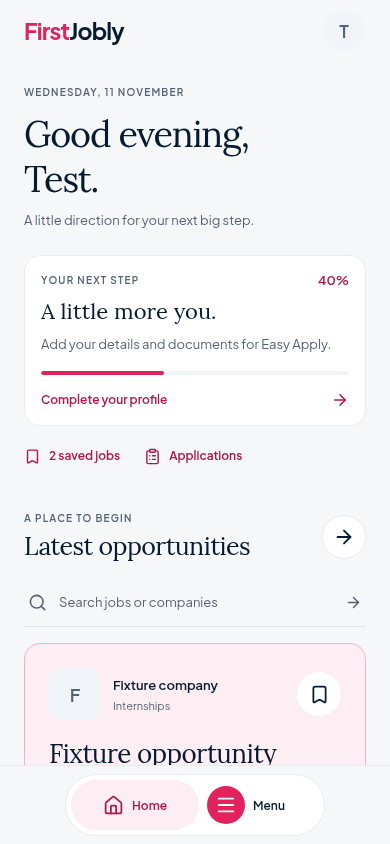
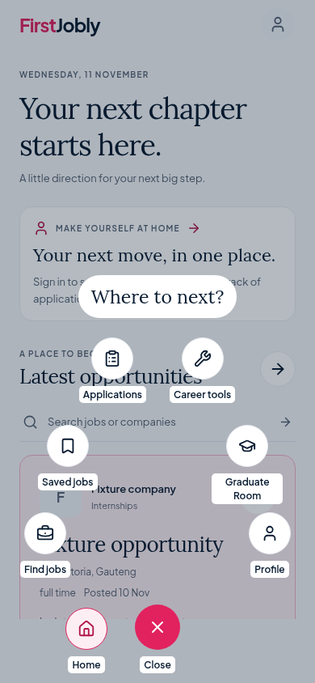
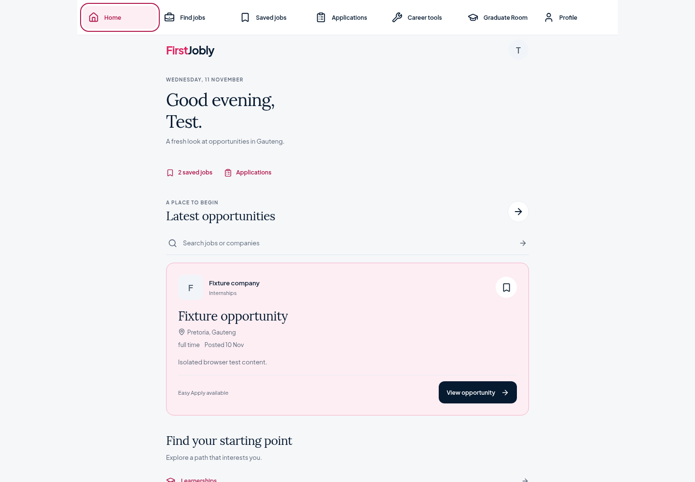

# Circular navigation and editorial Home

These are source changes based on GitHub main, not an update ZIP. The pink/navy brand colours, existing API integration, native ad behaviour, and all seven destinations are preserved.

## What changed

- A compact Home/Menu dock replaces the seven mobile tabs. Six secondary destinations expand into an elliptical arc with circular buttons and visible labels. The launcher becomes a visible close control; Home remains accessible. Full labelled hit areas are sized separately from the circles so targets and text do not overlap on small screens.
- Modal navigation supports a backdrop, selected states, keyboard focus management, Escape, focus restoration, native back requests, safe-area padding, keyboard hiding, and reduced motion. Desktop keeps a full navigation bar with arrow-key focus handling. Short-height browser windows can scroll the arc rather than clipping destinations.
- Home leads with a real date and personal greeting, followed by a real draft application or profile-completion panel where available. Latest opportunities follow, with search integrated into that section and the first available job given a prominent card with separate save and detail actions.
- A bundled, OFL-licensed Lora face supplies editorial headings; Plus Jakarta Sans remains the interface face. Main headings in existing jobs, saved jobs, applications, career tools, community, profile, and job details use the shared editorial token.
- No recommendation scores, salaries, company identity, or account data are fabricated. Failed personal-data requests remain unavailable. A failed saved-job query disables the save control with an unavailable state instead of claiming a known saved status. Company/account images retain their actual associations and have cached, sized fallbacks.
- Normal sign-in/sign-up opens Home unless a supported internal return destination was provided. Contextual sign-in retains the job, saved-job, application, profile, community, CV-maker, or Z83 route. No global redirect overrides explicit launch links.

## Preview

These screenshots contain isolated test fixtures, not real users, companies, account progress, or job listings.

| Mobile Home | Expanded navigation |
| --- | --- |
|  |  |



**The prototype image was not attached.** The implementation follows the written hierarchy and interaction requirements. No exact image match is claimed or verified.

## Run

Keep your existing `.env.local` values. Install the locked dependencies, then start Expo:

```sh
npm ci
npm run typecheck
npm run test:navigation
npx expo start --clear
```

For optional browser verification, install Playwright without changing the dependency manifest, start Expo web in another terminal, and run:

```sh
npm install --no-save --package-lock=false playwright
npx playwright install chromium
node scripts/verify-ui.cjs
```

The script accepts `APP_URL`, `CHROMIUM_PATH` (default `/usr/bin/chromium`), `PLAYWRIGHT_MODULE`, and `SCREENSHOT_DIR`. On Windows, set `CHROMIUM_PATH` to your installed Chrome executable. All Supabase responses are isolated fixtures; the script performs no real-account authentication or production writes.

## Verification and existing limitations

- TypeScript passes. The original source had two type errors: a potentially null application response and a missing CSS module declaration. A narrow null-response guard and CSS declarations fix those without changing backend operations.
- Five unit tests cover normal Home routing, internal return destinations, rejected external/malformed destinations, the existing profile-completion contract, and non-overlapping arc geometry at 320–768px with multiple text scales.
- Browser checks cover mobile/tablet widths of 320, 390, 430, and 768px, plus 1440px desktop. They verify labelled target geometry, viewport bounds, all destinations, focus cycles, expanded states, Escape, Home return, browser back, desktop keys, profile/error/empty states, save/unsave, draft resumption, default login, explicit returns, and job deep links. Screenshots were inspected at mobile and desktop sizes.
- Production web and Android bundle exports pass. JavaScript/Hermes export is not a native APK/IPA build or physical-device certification.
- Targeted lint passes for the new navigation, Home, shared components, summary hook, routing/layout helpers, platform adapters, and test scripts.
- Full-source ESLint under the same Expo rules reports 31 errors/36 warnings on the original GitHub source and 26 errors/29 warnings after this change. No new error signatures were introduced. Remaining failures are pre-existing hook-effect/ref/purity and unescaped-copy issues; they were not hidden with rule suppressions. ESLint and its Expo config were added as development dependencies so the repository's existing lint command is usable.
- The original web export failed on native-only Google Mobile Ads imports. Web-only adapters now omit unsupported native inventory while native source stays unchanged. A browser-only PDF-library entry fixes the existing `tslib.default` interop crash that prevented routes from loading on web; native keeps the standard PDF entry.
- The missing iOS AdMob app-ID warning remains. No identifier was invented.
- Real Supabase permissions, production sign-in/application submission, native safe-area/keyboard/back behaviour on devices, notification delivery, and native release signing remain unverified. No separate employer Home or mandatory onboarding route exists in this codebase; existing eligibility and community verification logic are preserved.
