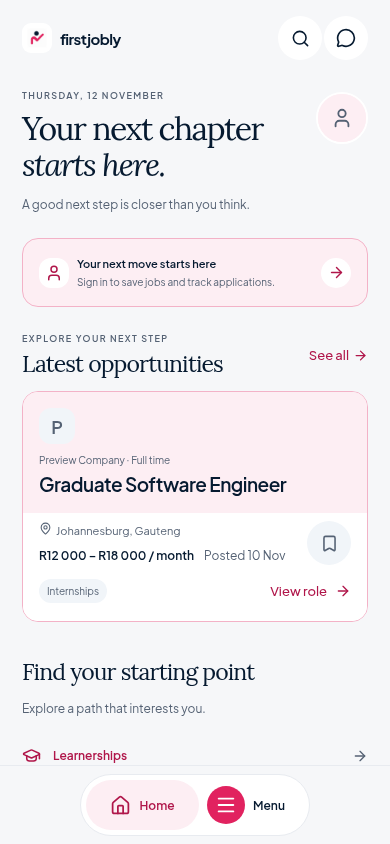
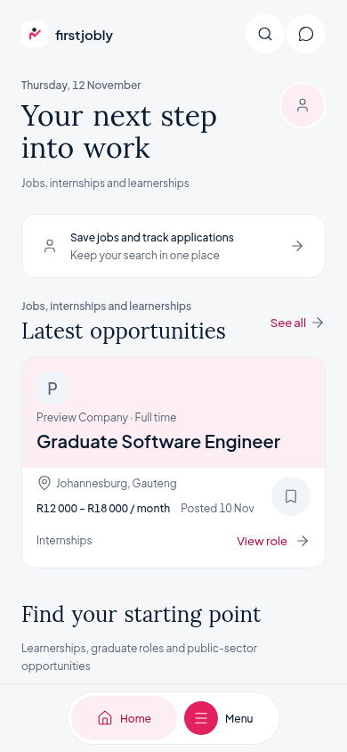

# FirstJobly — Unslop refinement

Based on main commit `1e5189d`, preserving the circular navigation, editorial
headings, seven destinations and latest Home integration. This is an app-wide
presentation pass, not a replacement of the recent prototype work.

Applied using **Unslop by Damir Sokolovsky ([@heydamir](https://x.com/heydamir))**,
[skill source](https://github.com/heydamir/unslop/tree/main/skills/unslop), licensed
[CC BY 4.0](https://creativecommons.org/licenses/by/4.0/). Changes below adapt that
workflow to FirstJobly's React Native app.

## Audit and direction

The remaining signs were 9–10.5px metadata, widely tracked uppercase captions,
greeting-led headlines, repeated pink panels, 700–800 text weights, many spacing
values, mixed Lucide/Ionicons styling, arbitrary community tag colors and looping
skeletons. The circular menu and Lora headings were already deliberate choices;
they are preserved.

- **Product:** Early-career job search for South African applicants.
- **Character:** Calm, practical, encouraging.
- **World:** Applications, CVs and the first step into work.
- **Moments:** The first real opportunity and actual profile/application progress.
- **Signature:** Quiet opportunity-type labels beside useful job information.

## Nine passes

1. **Spacing:** Styles use a 4px rhythm for ordinary padding, gaps and margins;
   2px optical/control nudges and calculated radial positions remain intentional.
   Touch targets remain at least 44px. Existing section order is retained.
2. **Color:** Existing pink/navy fills and neutral canvas remain. Text and inputs
   now consume shared tokens, secondary text/input boundaries have stronger
   contrast, and text on pink tints uses the darker brand shade. The account prompt
   is neutral so the first job can carry the colored moment. Community types use
   text labels rather than an unrelated rainbow.
3. **Icons:** UI glyphs use Lucide, an 18px control size and 1.5 stroke. Small
   selected-state ticks and identity images retain their own roles and sizes.
   Existing Ionicons names use a narrow compatibility component, avoiding a route
   or event-handler rewrite.
4. **Copy:** Home names the job-search context instead of greeting the user. The
   person's name stays in the date/context line. No fake roles, statistics, match
   scores, salaries or capabilities are introduced. Interface copy is shorter;
   category and account actions remain available.
5. **Type:** Lora remains for editorial headings; Plus Jakarta Sans remains for
   controls and body text. Most text uses 400–500, with 600 for limited emphasis.
   Small metadata is generally 12px; constrained radial labels remain 11px.
   Uppercase tracking and italic greeting emphasis are removed. Shared text uses
   tabular figures, and unused heavy/italic font faces no longer delay launch.
6. **Layout:** Existing Home order, search lists, form sections, desktop navigation
   and circular mobile navigation are retained. The dock always says “Menu” so a
   long current destination cannot truncate the action; its accessible name still
   announces the current page. Job titles wrap fully rather than hiding the end.
7. **Details:** Shared control radii, readable input boundaries, focus rings,
   selected states and real job metadata are consistent. Search/saved rows use the
   existing salary/type/date renderer only when the data exists. Visible field
   labels are passed to the shared input's accessible name.
8. **Visuals:** Real company images and profile images remain associated with their
   data. Existing fallback initials remain. No generated hero, illustration or
   decorative filler was appropriate for this app, so no image prompt was used.
9. **Motion:** Loading placeholders are static. Navigation keeps its purposeful
   open/close transition and focus management. Page transitions now respect the
   existing reduced-motion preference.

## Coverage

Presentation changes cover all 14 existing screens: Home, jobs/search and filters,
job details/Easy Apply, saved jobs, applications/history, profile, tools, auth,
CV Maker, Z83, GraduateRoom feed, composer, verification and discussion/reporting.
Shared profile/document/experience editors, selection sheets, empty/error/loading
states, sponsored presentation, launch screen and navigation also use the system.
Unused starter animated-icon demos and generated files are outside the live UI
scope. Auth, API contracts, native ad callbacks, eligibility, data associations,
PDF generation and routing logic are retained.

## Before / after

Both captures use the same isolated test job and phone viewport. These are test
fixtures, not a real applicant, employer, salary claim or production account.

| Before                                               | After                                              |
| ---------------------------------------------------- | -------------------------------------------------- |
|  |  |

## Validation

- TypeScript passes, as do all five existing navigation/routing tests.
- Web and Android Hermes production exports pass. These are bundle checks, not
  an APK installation or device certification.
- All 211 browser assertions in `scripts/verify-ui.cjs` pass, including 320px,
  390px, 430px, 768px and 1440px widths, focus handling, menu geometry, all seven
  destinations, Home states, save/unsave, draft resumption and sign-in returns.
- The independent 14-route visitor/member sweep at phone and desktop sizes passes:
  56 route renders without runtime exceptions or document overflow.
- Full-source lint has 13 pre-existing errors and 21 warnings, compared with 26
  errors and 29 warnings on the starting main commit under the same rules. There
  are no new file/rule/severity findings and no new suppressions.
- Text contrast against the canvas is 16.35:1 for primary and 5.79:1 for secondary
  text. The original pink button fill is retained at 4.57:1 against white; darker
  brand ink on pink tint is 6.11:1. Input boundaries are 3.12:1 against white.
  These token checks do not constitute a complete accessibility audit.
- `git diff --check` passes. No runtime or development dependencies were added.

Validation uses isolated
account/job responses and performs no production writes. Existing test coverage
includes navigation geometry/focus, seven destinations, saving, draft resumption,
account states and authentication return paths. Phone/desktop route checks cover
all 14 screens; tablet widths are included in the navigation suite.

Native device ads, keyboard/pickers/signatures/sharing, real account delivery and
physical Android/iOS rendering still require device validation. The existing
missing iOS AdMob app-ID warning is not changed or guessed.
