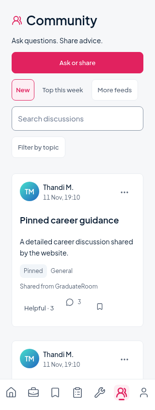

# Community UI refinement

Branch: `fix/community-feed-polish`. Based on `fix/home-nav-login-brand`; main is untouched.

## What changed

- Compact Community header and “Ask questions. Share advice.” supporting line.
- One primary “Ask or share” action. New and Top this week stay visible; More feeds exposes Following, Saved and My posts. Following still sends `scope: "foryou"`.
- Debounced search, a collapsible topic filter using the existing eight topic values, and a filtered-empty explanation with Reset filters.
- Discussion titles carry the hierarchy. Author details stay secondary; topics and real GraduateRoom attribution are plain metadata. Helpful, reply counts and the saved state remain visible. More reveals Follow, Report and eligible owner actions without nesting them inside the title's navigation target.
- Shared Plus Jakarta Sans, theme surfaces, 24dp gutters, small-radius cards and canonical pink primary buttons. Avatar hue gradients remain because they are required by the audited identity contract; no profile photos or decorative effects were introduced.
- Composer order is Title → Topic → Message, with plain placeholders. Existing photo attachment, anonymous explanation, validation and draft recovery remain intact.
- Replies use 8dp indentation per supported level. Status notices, reply context and existing ownership controls remain.
- In-memory feed filters/search/position survive discussion navigation. This UI state is owner-checked and cleared with the existing cache on sign-out/account change. Background scroll events cannot overwrite the active position. Requests and backend caching are unchanged.

## Changed files

- `src/app/(tabs)/community.tsx`: discovery controls, empty state and feed position restoration.
- `src/components/community/post-card.tsx`: discussion hierarchy and secondary action disclosure.
- `src/components/community/shared.tsx`: shared Community spacing, quieter buttons and canonical primary colour.
- `src/app/community/new.tsx`: field ordering and placeholders only.
- `src/app/community/[postId].tsx`: reply indentation only.
- `src/lib/community/contract.ts`: feed display order and Following label only; action values unchanged.
- `src/lib/community/store.ts`: account-isolated ephemeral feed view state only.
- `scripts/test-community.cjs`, `scripts/verify-community.cjs`: updated UI interactions and regression coverage.

## Verification

- TypeScript and focused ESLint pass.
- 22 Community unit tests pass, including cache/draft isolation, API validation, transport errors, optimistic mutations and feed view-state clearing on account change/sign-out.
- 76 Chromium checks pass using intercepted auth/API responses only: feed, all scopes, exact topic values, debounce, empty/reset, pagination, optimistic toggles/rollback, reports, composer/draft recovery, photos, owner edits/deletes, thread depth, legacy ID resolution, guest/incomplete/suspended/new-account rules, token refresh, error/retry, slow loading, long content, large counts and increased text size.
- Feed/detail exercised at 320dp; presentation stress at 360dp and 768dp. Scroll-return regression restores the same offset (2074 → 2074 in the final full run).
- Web export passes. AST comparisons confirm mutation handlers in composer/detail/cards are unchanged; protected backend, auth, ads, tab routes, draft services and dependencies have no diff.
- No live posts, comments, reports or other writes were made. No invented data is included in production; screenshots use isolated fixtures.

## Preview

## Limits

Physical Android/iOS keyboard, safe-area and system-font rendering were not verified. Browser font enlargement exercises responsive wrapping but does not substitute for native accessibility testing. Live backend behaviour was not retested with a real member account. The existing app's unrelated lint/SDK package issues were not changed; only relevant checks were run for this task.
