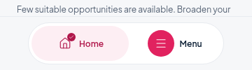
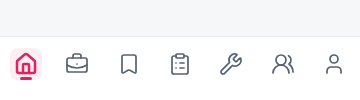
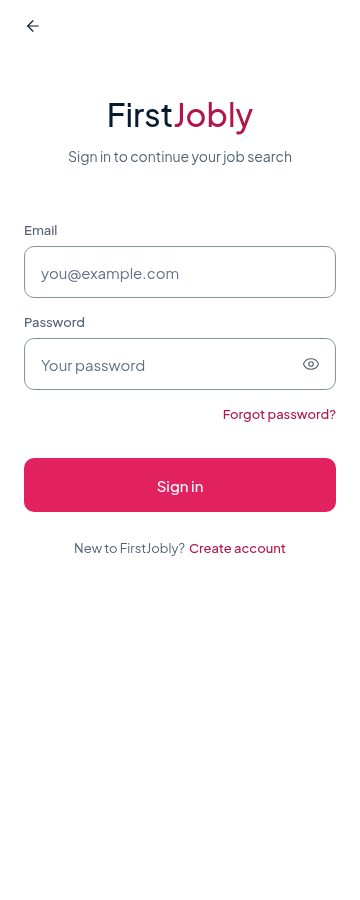
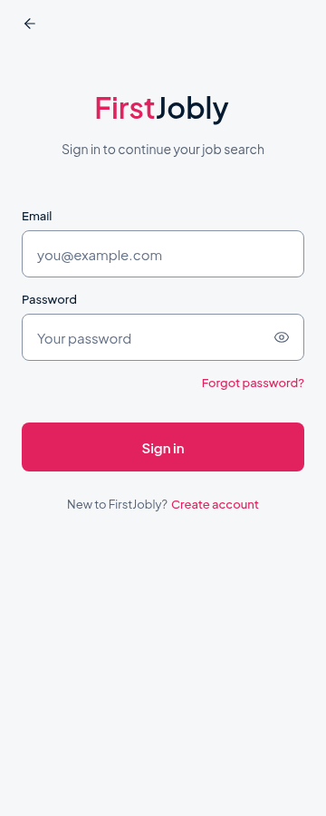
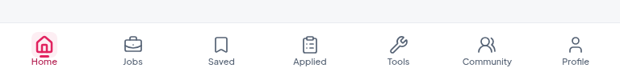
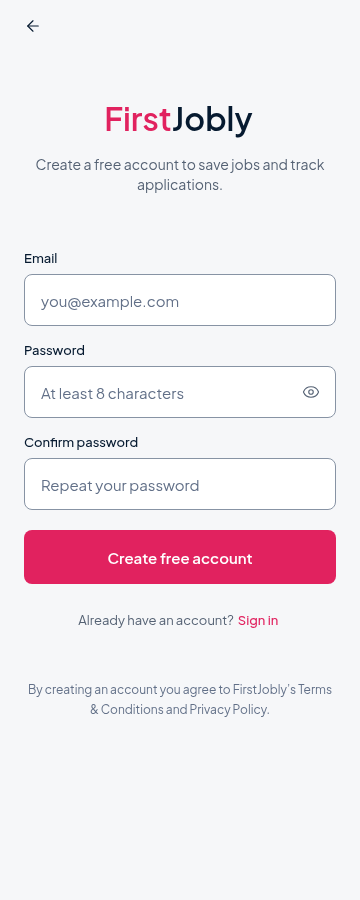
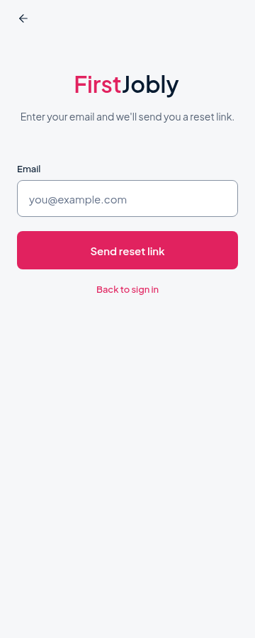

# Home, tab bar and auth branding

Branch: `fix/home-nav-login-brand`, based on `codex/brand-navigation-hot` (`f650e71`).
This change is UI only. Main is not updated or merged.

## Before / after (360px browser preview)

These are screenshots of the actual app with intercepted fixture data, not
mockups. They are browser previews, not physical Android screenshots.

| Area | Before | After |
|---|---|---|
| Home header |  |  |
| Bottom navigation |  |  |
| Categories |  |  |
| Login |  |  |

The baseline branch already displayed the complete two-tone Home wordmark in this
normal-size browser preview. This change adds the requested native single-line
fit fallback and explicitly protects header action space; it does not fabricate a
missing letter in the before screenshot. The final `y`, shared baseline and
42px enlarged-wordmark layout are verified independently.

At **360dp, icons-only was chosen**. All seven full labels cannot comfortably fit
at 10–11px with adequate spacing. Each tab has a full accessibility label; selected
state uses pink tint, a soft surface, heavier icon stroke and a small underline.
At widths >=560dp, complete labels appear below the icons at 11px with font scaling
disabled. Both modes use equal flexible item widths and safe-area bottom padding.
There are no partially visible words or mixed icon/text modes.



Visible order: **Home → Jobs → Saved → Applied → Tools → Community → Profile**.
Community retains the existing Room position. Route names/order, the hidden
GraduateRoom alias, initial destination and history behaviour are unchanged. This
uses the existing Expo Router Tabs implementation; no navigation library is added.

## Changes

- `src/components/brand-wordmark.tsx`: same Text with nested First/Jobly spans,
  existing Plus Jakarta Sans bold face, flexShrink:0, one line, adjustsFontSizeToFit,
  minimumFontScale:0.85, glyph padding and matched baseline.
- `src/constants/theme.ts`: semantic BrandColors aliases point to existing
  canonical primary pink (`#E1225F`) and navy (`#061A30`) tokens.
- `src/lib/brand-layout.ts`: optional preferred display size lets Home and auth
  reuse the same width-aware wordmark without adding a font.
- `src/app/(tabs)/_layout.tsx`: seven bottom tabs, responsive complete-label/icon
  choice, 24px icons, selected shape/weight, explicit accessibility labels, flexible
  items, >=44dp targets at the tested phone widths and safe-area spacing. The
  existing interaction observer is notified as before; no ad logic is modified.
- `src/lib/home-presentation.ts`: deterministic tab/grid layout budgets.
- `src/app/(tabs)/index.tsx`: non-shrinking action group; category sizing uses the
  actual 24dp Home gutters. Equal two-column cards have a 12dp gap, shared radius,
  centered icon/label, two-line labels and balanced section margins. Narrow/large
  system text switches the grid to one column rather than cutting labels.
- `src/app/auth.tsx`: shared canonical wordmark across Sign In, Sign Up and Forgot
  Password; pink actions/links, white action text, navy labels, common background,
  field surfaces/borders/radii, and centered readable form width. Inputs/buttons
  use minimum heights so larger text can grow instead of being cropped.
- Browser/presentation checks and the startup test's Home assertion. The latter
  now checks the selected Home tab and URL instead of requiring the retired menu.

Additional auth previews:

| Sign Up | Forgot Password |
|---|---|
|  |  |

## Scope preservation

Source comparisons against the base commit confirm unchanged:

- validateEmail, signIn, signUp, forgotPassword and submit handler ASTs;
- auth state, validation inputs, normalisation and router/Supabase calls;
- Home router calls, category destinations and tab route names/order;
- Supabase/auth libraries, Community/Hot/personalization services, AdMob code,
  job-detail/Apply, CV and Z83 files, native/build configuration and dependencies.

No backend writes, schema changes, authentication changes or live ad requests
were made for this UI verification. The earlier Hot backend review state is not
changed by this commit.

## Verification

- 134 real-app browser checks passed at 360, 390, 560 and 768px: brand spelling/colours,
  final y and baseline, enlarged header/action bounds, seven accessible tabs/order,
  targets and selected destinations, icon-only phone mode/full wide labels,
  equal cards/gaps/unclipped labels, all three auth modes and enlarged fields/actions.
- 40 startup/auth-return browser checks passed with intercepted auth/data.
- 3 presentation unit tests passed, including 3x system-text layout budgets.
- 10 review-scope source checks passed for the protected handlers/files above.
- TypeScript passed. Focused lint passed. Full lint has the identical baseline
  **9 errors and 16 warnings**, with no new findings.
- `npx expo-doctor`: **20/21 passed** through the environment proxy. Its remaining
  failure is the existing **21 SDK package-version mismatches**; the exact mismatch
  entries are unchanged. The first baseline attempt had two additional network
  failures, resolved using the supplied proxy. No packages were upgraded for UI work.
- Web and Android JavaScript exports succeeded. These are not APK/device tests.

No physical Android/iOS test was performed. Native font fitting and safe-area
behaviour still need confirmation on the installed app; the browser stress tests
and source/unit checks are not presented as on-device verification.

Commit message: `fix: home header/tab labels, categories spacing, brand login`.

## Pull and test (PowerShell)

```powershell
cd C:\Users\asus\firstjobly-native
git stash push -u -m "Before Home nav login fix"
git fetch origin
git switch fix/home-nav-login-brand
git pull --ff-only
npm ci
npx expo start -c
```

For an installed development APK, replace the final command with
`npx expo start --dev-client -c`. Local changes remain saved in the stash.
