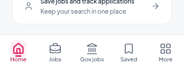
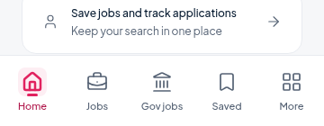

# Navigation label layout repair

The replacement request explicitly cancelled the circular/fan-menu redesign. This repair keeps the existing **Home / Jobs / Gov jobs / Saved / More** bar, its wording, icons, font, selected styling, route history, keyboard-hide behaviour and secondary More sheet. The unused legacy circular-navigation component remains unused and unchanged.

## Cause

The SDK 57 navigator's UIKit tab icon wrapper is **31 × 28**, but the app renders an existing **32 × 32** icon box inside it. Browser measurement before the fix showed the icon extending two pixels below its slot, directly into the label: at 360px, the icon ends at y=872 while the label begins at y=870. The mismatch is present for selected and inactive icons because the navigator stacks both versions in the same slot.

The custom label was also shrink-wrapped to its exact text width, with a tight **14px** line height. On Android, that provides little room for custom-font glyph ink at the final-letter boundary. No negative offset or selected-state transform caused the collision. The native last-letter truncation itself was not captured here; the slot overflow and two-pixel icon/label overlap were reproduced in the actual browser navigator.

## Small fix

Only `src/app/(tabs)/_layout.tsx` changes production behaviour:

- Give the navigator a **32 × 32** slot matching the unchanged icon box.
- Stretch the label frame across the available item width and centre the existing text; keep the existing 11px font, single-line wording and font-scaling policy.
- Use **18px line height**, Android font padding and a **2px** label-content gap.
- Derive the row minimum from the real components: `32 + 18 + 2 + 10 = 62px` (the navigator's vertical button padding is 5px on each side).
- Derive bar height from that row, its existing 8px top padding, the existing `max(bottomInset, 8)` bottom padding, and its hairline border. Web measurement changes from **72px to 79px**. Native growth is approximately 6–7dp because its hairline is fractional.

There is no arbitrary translation, new control, icon replacement, font shrinking, route change, animation change, backend work or advertising change.

The navigator remains in normal layout flow, so it reserves the revised bar height before laying out the screen. The existing shared content gutter remains unchanged; adding bar height there as well would double-pad the pages. Root job-detail screens do not show this tab bar, so it cannot stack over their fixed Apply footer.

## Before and after

Actual app screenshots, using isolated API responses at 360 × 900:

| Before | After |
|---|---|
|  |  |

## Verified

- **1,231 browser layout/behaviour assertions pass**, covering widths 320/360/390 and a **simulated** 34px bottom gesture inset.
- All five destination labels are complete, inside their hit targets, below their icon boxes and within the safe region. Icon boxes fit the navigator's slots; touch targets are at least 48 × 48 and do not overlap. Font size is unchanged.
- Each tab is checked selected and inactive, including More selected behind its existing sheet. Community and Profile remain reachable through More. Closing the sheet releases touches. Repeatedly selecting Home does not add browser history.
- The real virtualised Jobs list's final footer scrolls fully above the bar. An enlarged-page-text scenario retains aligned labels. A focused typing control remains above navigation with a reduced viewport.
- Root job-detail navigation remains hidden and its fixed Apply footer stays reachable. No new overlay is introduced. Advertising sources and placements are untouched; the regression run includes the existing ad tests.
- **120 existing Home/header/login browser checks pass** at 360/390/560/768px.
- **126 regression tests**, typecheck, focused lint and the Android production JS/assets export pass. The export is not a native APK/device test.

The browser cannot reproduce Android OS font scaling, the physical soft keyboard, a real gesture-navigation device or AdMob creatives. The current non-scaling navigation-label policy and `tabBarHideOnKeyboard` setting are preserved. Enlarged page text and gesture insets were simulated; an owner/device visual check remains appropriate. Full lint still reports the existing **9 errors / 16 warnings**, with no new focused-lint findings. SDK packages and dependencies are unchanged.

Run the focused browser check with a running Expo web server and the existing Playwright/Chromium setup:

```bash
APP_URL=http://localhost:8840 node scripts/verify-tab-labels.cjs
```

## Changed files

- `src/app/(tabs)/_layout.tsx` — the only production change.
- `scripts/verify-tab-labels.cjs` — layout and unchanged-behaviour regression checks with isolated APIs.
- `docs/navigation-label-layout.md` — cause, fix and verification report.
- `docs/navigation-label-layout/before-360.png` — baseline capture.
- `docs/navigation-label-layout/after-360.png` — repaired capture.
